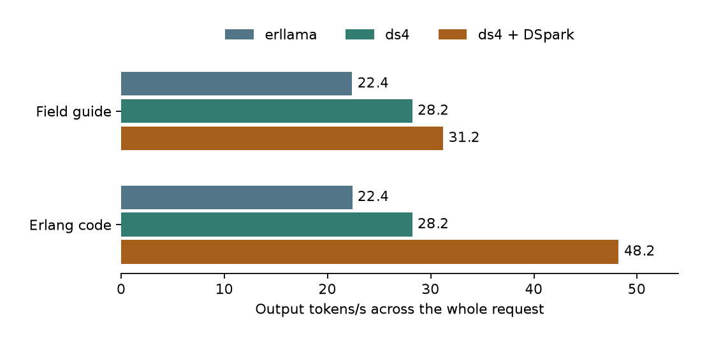

# DeepSeek Flash 0731 on two GX10s with and without DSpark

On 25 November 2026, we timed one prose request and one Erlang coding request.
Each returned 250 tokens. Adding the DSpark head to ds4 cut the prose reply
from 8.86 to 8.01 seconds and the code reply from 8.86 to 5.19 seconds.

| Mode | Prose, s | Prose, tokens/s | Code, s | Code, tokens/s |
|---|---:|---:|---:|---:|
| erllama ordinary | 11.17 | 22.37 | 11.17 | 22.38 |
| ds4 ordinary | 8.86 | 28.21 | 8.86 | 28.21 |
| ds4 with DSpark | 8.01 | 31.21 | 5.19 | 48.20 |

Both GB10s loaded the same 86.72 GB original mixed GGUF from local disk.
Each run used both hosts over RoCE, a 2,048-token context, greedy sampling,
one warm-up and one timed run per prompt. The prose request used 61 input
tokens, and the coding request used 70. We extracted the rendered prompts
from both ds4 traces, checked they matched, and passed the same token IDs
to erllama. Both ds4 modes reported zero cached tokens for the timed requests.
The erllama driver cleared its sequence before each request.

Rates divide 250 by the time from submitting the prompt to finishing the
reply, including prefill. The ds4 timer includes loopback HTTP streaming.
The erllama timer covers its rank API and ends at the last token ID.
The two ds4 rows share the same client. Their generated texts differed
on both prompts. This run measures speed and gives no quality score.

[Timings](results.csv) · [Prompts](prompts.json) · [ds4 revision](https://github.com/antirez/ds4/tree/b3f50180ec2c7324892be1f50bc83555ccb8d5e7) · [Original weights and 0731 DSpark head](https://huggingface.co/antirez/deepseek-v4-gguf/tree/f71f23d552d664e523b422157b2befbf74040380)

[Matched decode trace and expert-layout control](fixed-decode/README.md)
