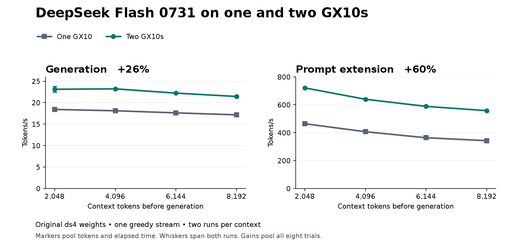

# DeepSeek Flash 0731 on one and two GX10s

## Scaling with the original ds4 weights

On the same erllama CUDA build and the same 86.72 GB GGUF, a second
GX10 over RoCE raised single-stream generation from **17.81 to 22.47
tokens/s (+26%)**. Prompt extension including the first decode rose
from **389 to 621 tokens/s (+60%)**. Two hosts were faster in all
eight generation pairs. [Single-host timings](single.csv) ·
[Two-host timings](baseline.csv)

| Context before generation | One GX10, decode | Two GX10s, decode | One GX10, prompt | Two GX10s, prompt |
|---:|---:|---:|---:|---:|
| 2,048 | 18.42 | 23.11 | 464 | 721 |
| 4,096 | 18.11 | 23.21 | 407 | 640 |
| 6,144 | 17.62 | 22.22 | 364 | 589 |
| 8,192 | 17.15 | 21.44 | 343 | 558 |

All rates are tokens/s. The single-GPU leg ran on rank zero first,
followed by an even split across both hosts. The benchmark used
the same README text, greedy sampler, 512-token batches, direct I/O,
9,216-token context, flash attention and identical prompt extensions.
Each leg ran the four depths twice in opposite orders after warm-up.
History was prefilled before the timer and checkpoint reuse was disabled.
Decode rates pool 127 token intervals per run. Prompt rates cover the new
2,048-token block through the first sampled token. Every run generated
128 tokens without EOG. This measures one stream.

To repeat the single-host leg, compile the [driver](../../context_sweep.erl)
and prepare the corpus as in the [context sweep](../../README.md).
On a free GX10 set `SWEEP_MODEL` to the original GGUF, `SWEEP_TEXT`
to the corpus and `SWEEP_OUTPUT` to the desired CSV. Start the CUDA
build of erllama with the compiled driver on the Erlang code path and
invoke `-s context_sweep cuda -s init stop`. Use the parent report's
split command for the two-host leg.

## Q5_K shared experts

The candidate converts 129 shared-expert matrices from the pinned DeepSeek
FP8 weights and scales using ggml Q5_K without an importance matrix.
The layer-zero probe used the same matrix shapes as one TP rank and the
actual ds4 Q8_0 blocks. Both formats ran with identical synthetic FP32
activations. The GPU cache was displaced before each timed graph and
the formats alternated order across pairs. [Paired layer timings](layer.csv)

| Batch | Q8_0 median | Q5_K median | Pairs faster with Q5_K |
|---:|---:|---:|---:|
| 1 | 68.2 µs | 46.7 µs | 99/100 |
| 512 | 327.2 µs | 317.5 µs | 37/40 |

The trial qualified for a full build. The prespecified rule required
at least 75 of 100 decode wins and a positive median paired saving in
both run orders. The two median savings were 21.6 and 21.4 µs.

## Full-model Q5_K result

Keep the original ds4 GGUF. Q5_K passed the overall quality limit and
three workloads. Chat's upper bound of +0.0206 exceeded the agreed +0.0200.
This closes the shared-expert precision experiment.

The Q5_K file generated 23.02 tokens/s. The original generated 22.47,
a change of +2.4% on the two-GX10 setup. Q5_K was faster in
8 of eight matched decode runs. Prompt extension was 619.0 versus
620.9 tokens/s (-0.3%). All runs returned 128 tokens
without EOG. The original ran in the first window and Q5_K in the second.
[Q5_K timings](candidate.csv) · [Original timings](baseline.csv)

**Quality gate failed.** Mean loss changed by +0.0072 nats/token
with equal weight for each workload. The limits agreed before scoring
were +0.0100 overall and +0.0200 for each workload's upper confidence
bound. Both files used identical token hashes and scored counts for all
56 documents and 57,281 tokens. Positive differences indicate higher loss.
The fresh baseline reproduced the scores of the earlier Q4_K comparison.
[Q5_K scores](candidate.quality.json) · [Original scores](../baseline.quality.json)

| Workload | Documents | Mean difference | Paired 95% interval |
|---|---:|---:|---:|
| chat | 16 | +0.0114 | [+0.0022, +0.0206] |
| code | 16 | +0.0058 | [-0.0003, +0.0119] |
| multilingual | 16 | +0.0068 | [-0.0053, +0.0189] |
| long | 8 | +0.0048 | [-0.0060, +0.0156] |

The new GGUF is 86,314,312,576 bytes. The 129 replacement tensors
came directly from DeepSeek FP8. We copied the remaining 1,199 verified
tensor payloads and GGUF metadata from the previous Q4_K candidate
to fit the available scratch disk. Their identity with the original
ds4 baseline was checked in the preceding experiment. Read-back verified
every tensor in the Q5_K file. [Checksum and manifest](manifest.json)

To reproduce, follow the [shared-expert build](../README.md).
Run the probe as `./shared_probe Q5_K`, and add `--format Q5_K` to both
`candidate.py quantize` and `candidate.py assemble`. Assembly accepts the
pinned original as `baseline.gguf` or the verified earlier candidate via
`--template PATH`. Work in a fresh directory for each format.
