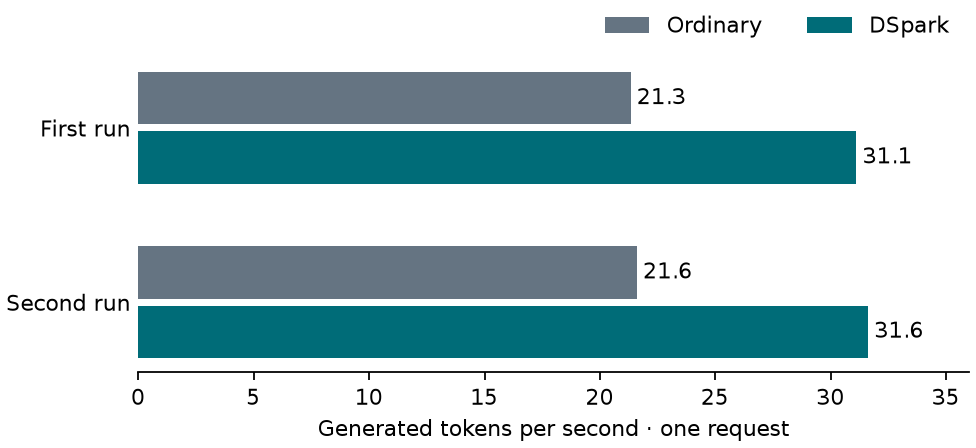

# DSpark on split DeepSeek V4 Flash 0731

On two GB10s the corrected DSpark probe generated **31.1–31.6 tokens/s** on the 70-token Erlang coding prompt. Ordinary decoding reached **21.3–21.6 tokens/s** in the same split context. All 65 greedy tokens matched within each repeat.

## Live verification

| Fresh rank group | Ordinary tokens/s | DSpark tokens/s | Ordinary time for 65 tokens | DSpark time for 65 tokens |
|---|---:|---:|---:|---:|
| First | 21.33 | 31.11 | 3.047 s | 2.089 s |
| Second | 21.60 | 31.62 | 3.009 s | 2.056 s |

Each repeat ran ordinary decoding first, enabled feature capture on both ranks, loaded the standalone head on rank 0, then ran 28 live verification rounds with up to two guesses. The target accepted 37 of 56 guesses (66.1%) and committed 2.32 tokens per round, counting the known token. Seven rounds rejected both guesses, five accepted one, and sixteen accepted both. The two repeats used the same prompt and greedy settings. Their agreement establishes repeatability on this prompt.

On average the head took 12.0–12.8 ms per round, target verification took 57.7–58.2 ms, and trimming plus feeding committed features took 2.8 ms. The rates use wall time around the decode loops in the native test harness, including Erlang calls. Model loading, prefill, time to first visible text and HTTP streaming are outside the timer. [Measurements](live.csv)

Both fresh groups passed the following checks.

- Cancelling a verified round discarded the two guesses and kept the known token. The position on both ranks was 135. The next four greedy tokens matched ordinary continuation from the saved boundary.
- Clearing and restoring both target cache shares and the head's own checkpoint in the same processes reproduced the two guesses and all three target predictions.
- With four active sequences, the harness ran eight ordinary batched steps. After releasing three slots, the remaining sequence resumed drafting and committed ten tokens in four rounds.

The probe selects the mode explicitly. Integrating that policy into erllama's scheduler and persisting the draft checkpoint through the serving cache are the next steps. The earlier ds4 comparison used a 250-token request through a different serving path. A matched server run is needed to compare the two engines.

## Target features

Two GB10s ran erllama's FP32 logits build (8a0ac02) with the same target GGUF and 70-token Erlang coding prompt as the prior decode comparison. We compared the features that the 0731 DSpark head reads at layers 41, 42 and 43 against a whole-model run on one GB10. All three used the same token IDs, 2,048 context tokens, four sequence slots, unified KV and two rollback snapshots per sequence.

| Features | Relative RMS difference from one GPU | Agreement between split ranks |
|---|---:|---|
| 70-token prefill | 0.106–0.130% | Byte-identical at all three layers |
| Next token, teacher-forced | 13.93–15.10% | Byte-identical at all three layers |

Rank 0 already holds a complete feature vector for this head. Adding the two rank vectors roughly doubles its magnitude. The continuation missed our predeclared comparison threshold of 10% relative RMS and 0.995 cosine. This experiment did not identify the source of that difference. [Per-layer comparisons](features.csv)

## Head replay

The ggml-org BF16 head (revision `64da7c18350c54db6406cd085731f2a34363bf66`) declares a five-position block and borrows the target token embeddings and output projection. We copied those two tensors into a temporary standalone draft GGUF from the original target, retaining their F16 and Q8_0 representations.

The first live attempt made 64 teacher-forced draft calls and produced zero guesses. Its context allowed one sampled output per sequence while the head requested four. A CPU replay with the backend sampler enabled reproduced the native error. Raising the limit to five produced guesses with both captured feature sources.

| Anchor position | Single-GPU features | Split features | Next two reference tokens |
|---|---|---|---|
| 70 | 442, 85 | 442, 85 | 344, 260 |
| 71 | 260, 5553 | 260, 5553 | 260, 5553 |

These two anchors establish that the split features can drive the actual head. They are too few to estimate an acceptance rate or serving speed. [Replay output](replay.csv)
