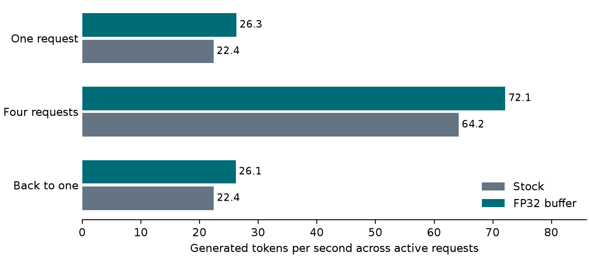

# DeepSeek Flash 0731 output reduction on two GB10s

One rank on each GB10 produced a partial FP32 score for each of 129,280 tokens. Stock erllama summed those scores in chunks of 32,000 floats to stay below llama.cpp's BF16 threshold. The patch reuses a device buffer and asks NCCL for FP32 explicitly. A single request takes one collective instead of five. Four concurrent requests take one instead of seventeen.

| Active requests | Stock tokens/s | Patched tokens/s | Stock ms/step | Patched ms/step |
|---|---:|---:|---:|---:|
| One | 22.37 | 26.28 | 44.71 | 38.05 |
| Four, aggregate | 64.16 | 72.11 | 62.34 | 55.47 |
| One, after releasing three slots | 22.40 | 26.14 | 44.64 | 38.25 |

Both builds ran on the same two hosts, first stock and then patched, with the same DeepSeek V4 Flash 0731 GGUF (SHA-256 `ca22ae2f838e14077c22bc1c1417b71b45b5e5a3687bd96c2ac6e17fdb6261c0`), direct I/O, 2,048 context tokens, four sequence slots, greedy sampling and drafting off. Each build ran a 70-token prefix followed by 48 single-request steps, 48 four-request steps and 24 final single-request steps. Three shorter prefixes joined the first request for the middle phase. The table divides generated tokens by elapsed time at the rank backend. It excludes the first 16, 16 and 8 steps of each phase respectively.

Taking the slower rank at each call, median time inside the logits sum fell from **2.55 to 0.66 ms** for one row and from **6.19 to 0.68 ms** for four. All 264 generated token IDs matched across builds, including all 48 single-request reference tokens. SHA-256 of the complete reduced buffer matched across both ranks and builds for the first three occurrences of each row count.

This was one stock/patched pair. The directly measured single-row reduction saving was 1.89 ms. The full step improved by 6.65 ms, so attributing the entire difference to the collective would require an alternating run. The older same-token ds4 run averaged 34.15 ms. These measurements cover warm decode. HTTP latency, in-flight cancellation and checkpoint restore were outside this run.

The benchmark build grew the staging buffer to the largest call. The final source caps it at 4 MiB per rank and splits larger outputs. All measured row counts fit in the cap. A CPU test of the final source checked growth, shrink, multiple chunks, exact FP32 data, the legacy path and recovery after a failed collective. The CUDA sources compiled on both hosts.

[Per-step times and generated IDs](steps.csv) · [Per-rank reduction times and sample hashes](reductions.csv)

## DSpark follow-up

The ggml-org 0731 BF16 head at revision `64da7c18350c54db6406cd085731f2a34363bf66` declares architecture `dflash`, block size 5 and target layers 41, 42 and 43. The pinned llama.cpp has a DSpark implementation and DeepSeek4 graph outputs for these layer inputs. erllama's current MTP adapter requires an MTP head. A DSpark trial needs its own draft context and the same target-layer capture configuration on both ranks.

Start with one greedy request and check the captured layer values against a reference before timing accepted tokens. At the next scheduling tick after another request arrives, yield to ordinary batching. Exercise a rejected draft, cancellation and a warm checkpoint restore before enabling it for users.
